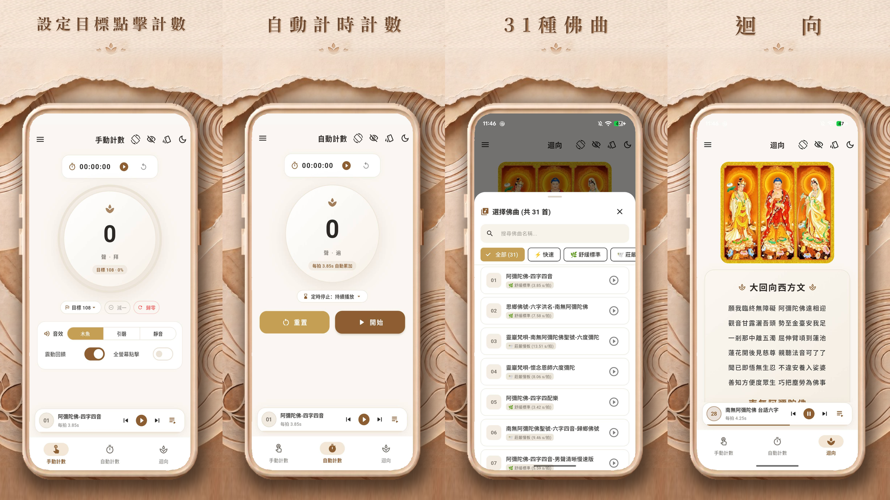

# 念佛計數器 (BuddhaCounter)

專為念佛、拜佛打造的隨身計數工具：點一下記一聲，或播放佛曲讓 App 跟著佛號自動計數，
每天的功課都記在月曆裡。

## 下載

- **iPhone / iPad**：[App Store](https://apps.apple.com/tw/app/%E5%BF%B5%E4%BD%9B%E8%A8%88%E6%95%B8%E5%99%A8/id965764032)
- **Android**：[Google Play](https://play.google.com/store/apps/details?id=com.yichung.lee.count4&pcampaignid=web_share)
- **電腦瀏覽器**：[網頁版](https://leemikepop.github.io/BuddhaCounter/)（免安裝；在 Chrome、Edge 網址列按「安裝」可以像 App 一樣從桌面開啟）

> 網頁版沒有背景播放保證、桌面小工具與每日提醒，紀錄只存在該瀏覽器裡。手機上建議下載 App。

本 App 由李義忠（阿忠）居士發心設計開發，最初於 Android 發布，提供念佛、拜佛的同修一個方便、
純粹的精進記數工具。為使這份心血長久傳承，現由後輩接棒維護，並推出 iPhone 版與全新介面。

---

## 功能

- **兩種介面，隨時切換**
  - **經典模式**：沿用最早 Android 版的版面（藍底聖號橫幅、超大計數鍵），習慣舊版的長輩一看就會。
  - **現代模式**：手動計數、自動計數、迴向、功課月曆四個分頁，左右滑動切換，下方常駐佛曲播放器。
- **手動計數**：念一聲、拜一拜就點一下；可選木魚、引磬音效或靜音，搭配震動回饋；可設定目標聲數。
- **自動計數**：播放佛曲時，每念完一句佛號自動加一。可設定「念滿幾聲」或「念幾分鐘」後自動停止。
- **31 首佛曲**：四字、六字彌陀，觀音、地藏、釋迦聖號，朝山聖號與六字大明咒等，可依分類篩選或搜尋。
  支援背景播放、單曲循環或依序播放，並可從通知欄、鎖定畫面、控制中心與耳機操作。
- **迴向**：大回向文與回向偈，念佛之後隨時迴向。
- **功課月曆**：每天的手動與自動聲數分開記錄，顯示連續精進天數與每週、每月統計；任何一天都可以補登或修改。
- **每日目標與提醒**：設定每天要念的聲數，並在固定時間收到念佛提醒。
- **桌面小工具**：不用開 App，就能在手機桌面看到今日功課、目標進度與連續天數。
- **多語言**：繁體中文、简体中文、English，預設跟隨手機語言。

---

## 使用方式

### 切換介面

- 現代模式：點右上角的按鈕切換回經典模式。
- 經典模式：在「設定」裡開啟現代模式。

兩種介面共用同一份計數與功課紀錄，切換不會遺失資料。

### 手動計數

1. 每念一聲（或拜一拜）就點一下大按鈕。開啟「全螢幕點擊」後，點畫面任何地方都算一聲，不用看著按鈕。
2. 點錯了可以按「−1」；按「歸零」重新開始（現代模式會先詢問，避免誤按）。
3. 想念滿一定聲數，可以設定目標，進度會顯示在畫面上。

### 自動計數

1. 到「自動計數」頁，選一首佛曲。
2. 按播放就開始計數，畫面會隨佛號一聲一聲累加；暫停播放就暫停計數。
3. 需要時設定停止條件：「念滿幾聲」或「幾分鐘後」（二擇一），時間到或念滿會自動停止。

自動計數的聲數也會記進當天的功課。

### 功課月曆

- 點月曆上的日期，可以查看當天的手動與自動聲數，也能補登或修改。
- 在月曆頁設定每日目標與每日提醒的時間。

### 桌面小工具

- **Android**：長按桌面空白處 →「小工具」→ 找到「念佛計數器」，拖到桌面。
- **iPhone**：長按桌面空白處 → 左上角「+」→ 搜尋「念佛計數器」，選擇大小後加入。

### 其他小技巧

- 念佛時螢幕不想自動變暗，可以開啟「螢幕常亮」；躺著或橫放手機時，可以鎖定螢幕方向。
- 語言可在選單（經典模式在「設定」）裡切換。
- 佛曲在背景或鎖定螢幕時會持續播放，可從通知欄或鎖定畫面暫停、換曲。

---

## 隱私

本 App 不需要註冊帳號，**不收集、不上傳任何個人資料**，也沒有廣告或追蹤。
所有計數紀錄與設定只存在您的手機裡；刪除 App 時資料也會一併清除。

- [隱私權政策（iOS）](https://www.leeyc.net/share/buddhacounter/iOS/privacy_policy.html)
- [隱私權政策（Android）](https://www.leeyc.net/share/buddhacounter/Android/privacy_policy.html)

---

## 聲明

- **程式碼授權**：本專案的程式碼以 [Apache License 2.0](LICENSE) 授權釋出。
- **佛曲錄音**：App 內的佛曲錄音來自各道場與法師、居士，皆允許免費公開散布；著作權仍屬原錄製者所有。
  曲目名稱與演唱者均標示於 App 內。
- **英文翻譯**：英文介面的佛教用語已對照公開的英文譯本整理，但尚未經熟悉佛教用語的人審閱，
  若有不妥之處，歡迎指正（用詞見 [術語表](lib/l10n/GLOSSARY.md)）。
- 本 App 為輔助修行的工具，計數結果僅供個人參考。

## 意見回饋

- 使用上的問題或建議，歡迎到 [阿忠小站](https://www.leeyc.net/phpBB3/) 留言，或在本專案開 Issue。
- 想參與開發或自行建置，請見 [開發指南](docs/DEVELOPMENT.md)。

南無阿彌陀佛 🙏
